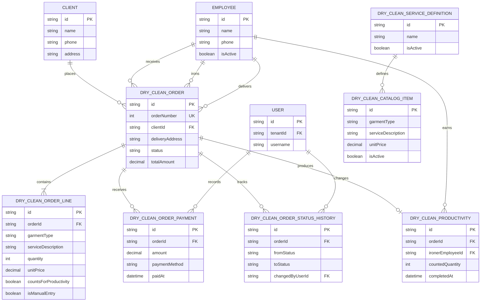

# Dry Clean Operations

A focused operations system for dry cleaning, garment cleaning, and ironing. It records customer orders, garment lines, receiving staff, ironers, delivery staff, order status, payments, delivery, and ironer productivity. The UI is Arabic-first and RTL; this documentation is maintained in English.

## Quick Start

Requirements: Windows, .NET Framework 4.8 Developer Pack, and Node.js.

```powershell
npm install
npx tsc --noEmit
npm run lint
npm test
npm run build
dotnet build backend-cs/pos-cs.csproj --configuration Release
```

For local development:

```powershell
npm run dev
dotnet run --project backend-cs/pos-cs.csproj
```

For the packaged application, run `start.bat`. The backend listens on `http://localhost:3001`, serves the API and static frontend, and applies all pending SQL migrations from `backend-cs/Database/Migrations/` on startup. The SQLite database is stored in the `data/` directory beside the executable.

Default credentials are `admin` / `1234`. Change them after the first login.

## Project Structure

- `backend-cs/`: C# .NET Framework 4.8, OWIN Web API, Dapper, and SQLite.
- `src/`: Next.js static export, React, TypeScript, and TanStack Query.
- `backend-cs/Database/Migrations/`: Ordered SQL migrations for the dry-clean schema and incremental updates.
- `messages/ar.json`: Arabic UI translations.
- `docs/DRY-CLEAN-PLAN.md`: Delivery plan.
- `docs/DRY-CLEAN-SPEC.md`: Detailed functional specification.
- [`BUSINESS-LOGIC.md`](BUSINESS-LOGIC.md): Workflow and business constraints.
- `docs/PERMISSIONS.md`: Roles and permission keys.

## Commands

| Command | Purpose |
|---|---|
| `npm run dev` | Start the frontend development server |
| `npm run build` | Build the frontend as a static export |
| `npm run lint` | Run ESLint |
| `npm test` | Run Vitest |
| `dotnet build backend-cs/pos-cs.csproj --configuration Release` | Build the backend |

## Database ERD



## Backup

Local backups and optional Cloudinary upload are available through `/api/backups`. Configure Cloudinary with `POS_CLOUDINARY_CLOUD_NAME`, `POS_CLOUDINARY_API_KEY`, and `POS_CLOUDINARY_API_SECRET`. The application remains usable locally when these variables are not configured.

## Authentication and Permissions

All endpoints except login and license checks require a Bearer token and the relevant permission. See `docs/PERMISSIONS.md` and `BUSINESS-LOGIC.md` for the access rules.
